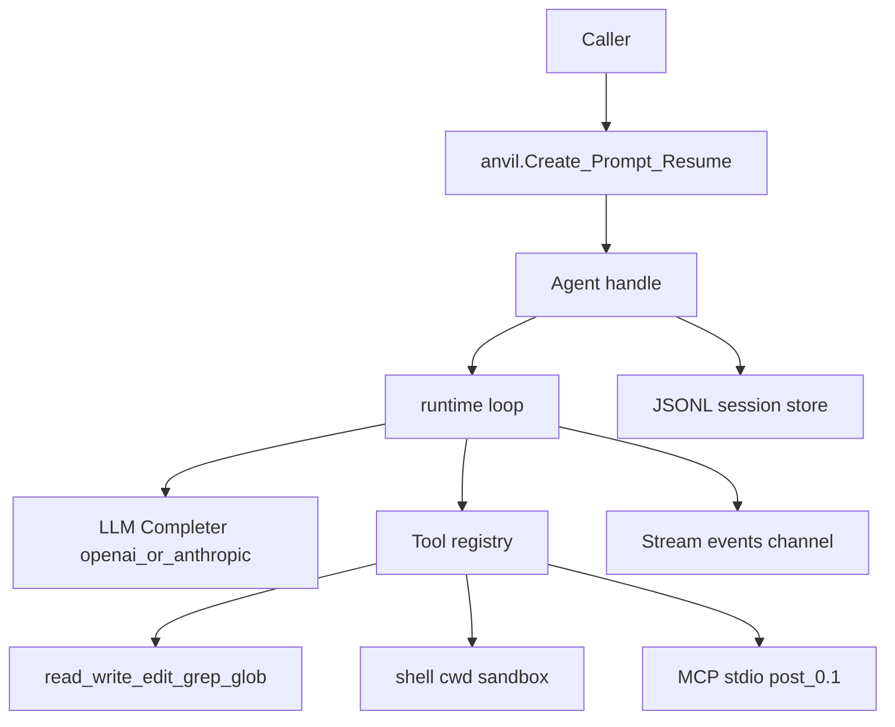

# 01 — Architecture

## Layers

```text
Caller app / CLI / CI
        │
        ▼
┌───────────────────┐
│  Public package   │  anvil: Create, Prompt, Resume, Agent, Run
│  anvil            │
└─────────┬─────────┘
          │
          ▼
┌───────────────────┐
│  internal/runtime │  tool-calling loop, MaxSteps, cancellation
└─────────┬─────────┘
     ┌────┴────┐
     ▼         ▼
internal/llm   internal/tools
 OpenAI-compat  read/write/edit/grep/glob/shell (+ later MCP)
     │
     ▼
internal/store   JSONL agent/run persistence
internal/prompt  system prompt templates
```

## Package layout (target)

```text
anvil/
  doc/
    design/v0.x/        # design cutoff (chapters)
    roadmaps/v0.x/      # milestones / phases
  source/               # Go module root
    go.mod
    agent.go
    options.go
    run.go
    errors.go
    types.go
    cmd/
      anvil/            # operator CLI
      agentd/           # worker-daemon (0.11)
      agent-worker/     # worker entry (0.11)
    internal/
      llm/
      runtime/
      tools/
      store/
      prompt/
      daemon/           # 0.11
      worker/           # 0.11
    examples/
      oneshot/
      interactive/
```

Process topology for multi-job hosts: see [11-worker-daemon.md](11-worker-daemon.md).

Default module path placeholder: `github.com/anvil-dev/anvil` (module root is `source/`).

## Data flow



## Concurrency

- One active Run per Agent at a time (MVP); concurrent Sends return an error.
- `Stream` is a receive-only channel (or iterator over channel) closed when the run ends.
- Cancellation via `context.Context` on `Send`/`Wait`/`Stream`, and `Run.Cancel` where implemented.

## Boundaries

| Layer | May depend on | Must not |
|-------|---------------|----------|
| `anvil` (public) | `internal/*` | leak OpenAI wire types in public API |
| `runtime` | `llm`, `tools`, `prompt`, `store` | talk HTTP directly |
| `tools` | stdlib + path sandbox helpers | call LLM |
| `llm` | `net/http` | execute tools |
| `store` | filesystem | call LLM or tools |
